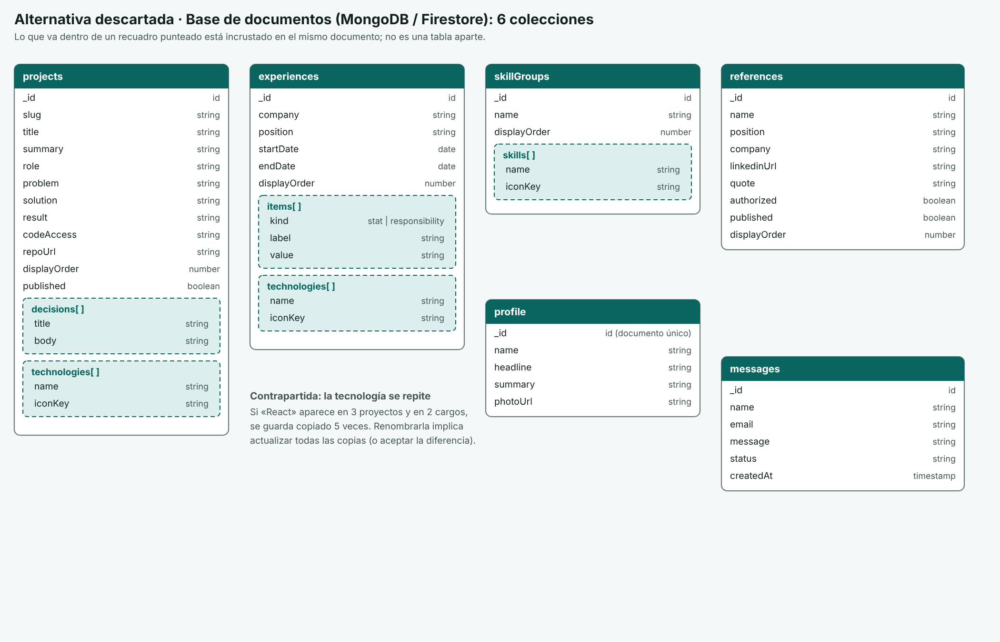

# ADR-005: PostgreSQL en lugar de una base de documentos

**Estado:** Aceptado · **Fecha:** 2026-10-24 · **Decisores:** Anderson Zapata

## Contexto

- El contenido tiene relaciones muchos a muchos (proyectos, experiencia y tecnologías) y reglas de integridad: por ejemplo, una referencia no puede publicarse sin autorización y sin enlace de LinkedIn ([backend-research-definition §4](../architecture/backend-research-definition.md)).
- El stack cerrado en descubrimiento ya incluía PostgreSQL ([01-discovery](../discovery/01-discovery.md)).
- La operación debe ser gratuita (RNF-11) y portable ante cambios de condiciones de los planes ([05 §6](../architecture/05-arquitectura-tecnica.md)).

## Decisión

**PostgreSQL en Neon** (decisión 3 de [05 §2](../architecture/05-arquitectura-tecnica.md)), con Prisma 7 como ORM (decisión 13; versión y conexiones en ADR-019).

El modelo relacional elegido tiene **15 tablas** tras la Fase 0: `profile`, `profile_highlight`, `project`, `project_decision`, `project_flow_step`, `technology`, `project_technology`, `experience`, `experience_item`, `experience_technology`, `skill_group`, `skill`, `reference`, `contact_message` y `publish_event`. Las reglas se aplican en la base con `CHECK`, `ON DELETE` (cascada en hijas y tablas puente, `RESTRICT` al borrar una tecnología en uso) e índices en toda clave foránea. Los UUID los genera la base con `gen_random_uuid()`.

Diagramas: `../architecture/img/modelo-relacional-elegido.png` (elegido; aún muestra la versión de 12 tablas hasta la rama `feat/db-schema`) y la alternativa descartada:

## Alternativas consideradas

- **Base de documentos (Firestore, MongoDB Atlas).** Descartada: las relaciones muchos a muchos con tecnologías y la integridad referencial se resuelven mejor en un modelo relacional; además PostgreSQL aporta portabilidad y valor para el perfil profesional. Modelo descartado en `../architecture/img/modelo-documentos-descartado.png`.
- **Supabase** (PostgreSQL gestionado). Descartada: se pausa tras una semana de inactividad.

## Consecuencias

**Positivas**
- Integridad garantizada por la base (restricciones `CHECK`, claves foráneas), no solo por la aplicación.
- PostgreSQL estándar: los datos se pueden mover a otro proveedor (plan B de portabilidad).

**Negativas**
- Neon gratis solo conserva 6 horas de historial: hace falta un volcado semanal cifrado a un bucket privado y probar la restauración (decisión 12, rama `ci/db-backup`).
- Neon suspende el cómputo por inactividad: el primer acceso suma arranque en frío (mitigado por ADR-003).
- Cada cambio de esquema exige una migración versionada (ADR-019).

## Cuándo revisarla

- Si el contenido deja de ser relacional (por ejemplo, documentos libres sin relaciones).
- Si Neon cambia sus condiciones gratuitas: se migra a otro PostgreSQL, no se cambia de paradigma.

## Fuentes

- [docs/architecture/05-arquitectura-tecnica.md](../architecture/05-arquitectura-tecnica.md) (§2 decisiones 3, 12 y 13; §3; §6)
- [docs/architecture/backend-research-definition.md](../architecture/backend-research-definition.md) (§4)
- [docs/discovery/01-discovery.md](../discovery/01-discovery.md)
- Neon, precios: https://neon.com/pricing · Supabase, precios: https://supabase.com/pricing (revisión de límites del 2026-10-24)
